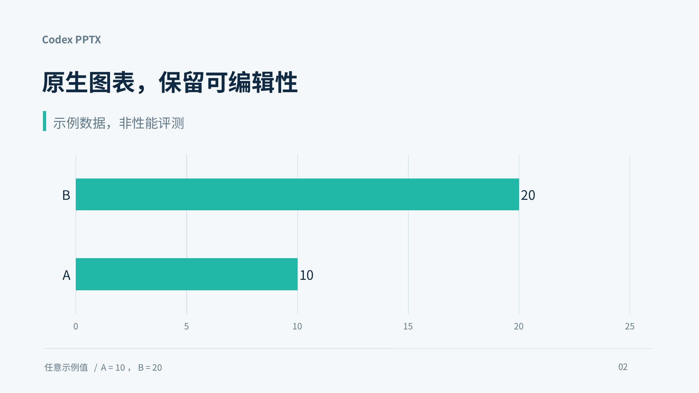

<p align="center">
  
</p>

<p align="center">
  <a href="https://github.com/yss-off/codex-pptx/actions/workflows/tests.yml"></a>
  <a href="LICENSE"></a>
  <a href="plugin.json"></a>
  <a href="requirements-dev.txt"></a>
</p>

<p align="center"><strong>让 Codex 把内容变成可编辑、可检查的 PowerPoint。</strong><br>从新建演示文稿到模板编辑，提供生成、渲染与质量检查的一套工作流。</p>

<p align="center">中文 · <a href="README.en.md">English</a> · <a href="#快速开始">快速开始</a> · <a href="docs/validation.md">验证记录</a> · <a href="CHANGELOG.md">更新记录</a></p>

## 能做什么

| 工作流 | 交付与检查 |
|---|---|
| **从内容创建** | 使用 PptxGenJS 生成可编辑文本、图形、表格和原生图表 |
| **按模板修改** | 解包、复制、重排和清理页面，保留模板结构 |
| **预览与检查** | 提取正文、渲染 PDF 和页面图片、检查 Office XML 与资源引用 |

这是一个 Codex 插件：技能指南和本地脚本一起分发，**无需额外搭建 MCP 服务**。
插件提供工作流；生成质量仍需要内容核对和实际渲染检查。

## 真实运行预览

下面两页由安装后的插件在 Codex 新会话中生成，并通过 LibreOffice 渲染。
图表使用明确标注的示例数据；不是性能或效果评测结果。

<table>
  <tr>
    <td width="50%"></td>
    <td width="50%"></td>
  </tr>
</table>

[下载可编辑示例 PPTX](examples/codex-pptx-example.pptx)

## 快速开始

### 1. 准备本地依赖

需要 Codex、Python 3.10+、Node.js/npm、LibreOffice 和 Poppler。

```bash
python -m pip install 'markitdown[pptx]' Pillow lxml defusedxml
npm install -g pptxgenjs
```

Ubuntu / Debian 的系统依赖示例：

```bash
sudo apt install libreoffice poppler-utils fontconfig fonts-noto-cjk
```

中文幻灯片需要可用的中文字体。图标可选依赖为 `react-icons`、`react`、
`react-dom` 和 `sharp`。受限 Linux 环境的 LibreOffice socket 兼容分支需要 `gcc`。

### 2. 从 GitHub 安装

```bash
codex plugin marketplace add yss-off/codex-pptx --ref main
codex plugin add codex-pptx@personal-pptx
codex plugin list --json --marketplace personal-pptx
```

桌面客户端也可在插件目录中选择 **Personal PPTX** 来源后安装。
CLI 路径已实测；桌面界面的安装操作未单独验证。

**已有独立 `pptx` 技能？** 先备份，再将旧目录移到技能发现目录之外，
只保留插件入口，避免旧版与新版重复加载。不要将备份留在 `skills/` 下。

### 3. 在新聊天中使用

```text
使用 codex-pptx:pptx，根据下面的内容制作一份中文演示文稿。
保留原生可编辑图表，完成文本核对和逐页渲染检查，交付最终 PPTX。
```

也可以要求“按现有模板调整页面顺序并替换内容”或“检查这份 PPT 的内容和排版”。
现有聊天可能仍持有原来的技能上下文；切换后用新聊天核对加载来源。

## 工作方式

```text
内容与模板 → 选择创建或编辑路径 → 生成 / 修改 PPTX
                                      ↓
                 交付 PPTX ← 修正问题 ← 文本 + 结构 + 渲染检查
```

`pack.py` 默认执行校验。`--original` 用于区分原文件已有的 XSD 错误，
不是开启校验的开关；只有明确传入 `--validate false` 才跳过校验。
复制页面时会独立复制图表及其可编辑依赖，原页面的演讲备注不自动继承。

## 项目结构

```text
codex-pptx/
├── plugin.json                  # Codex 插件入口
├── .agents/plugins/             # 可从 GitHub 安装的插件目录
├── skills/pptx/
│   ├── SKILL.md                 # 入口与工作约定
│   ├── references/              # 生成、设计和检查指南
│   └── scripts/                 # 生成、渲染和 Office XML 工具
├── tests/                       # 生成、编辑与校验的行为回归测试
└── docs/                        # 验证记录和展示素材
```

## 测试与贡献

```bash
python -m pip install -r requirements-dev.txt
npm install -g pptxgenjs@4.0.1
python -m unittest discover -s tests -v
```

测试在临时目录运行，无需模型调用或显卡。生成集成测试需要 Node.js 与 PptxGenJS；
缺少依赖时明确跳过，不能视为完整验证。GitHub Actions 配置在 Python 3.10 和 3.13
上安装固定的生成器版本并运行检查。已验证 Linux CLI 安装与调用；Windows/macOS 尚未验证。

发现问题或希望改进工作流，欢迎提交 [Issue](https://github.com/yss-off/codex-pptx/issues)
或 Pull Request。参见[贡献说明](CONTRIBUTING.md)、[验证记录](docs/validation.md)和[更新记录](CHANGELOG.md)。

## 许可

本项目原创内容采用 [MIT License](LICENSE)。第三方 Office XML schema 保留原有内容与声明，
其权利和许可不由本项目的 MIT 许可替代。

插件结构参考 [OpenAI 官方插件文档](https://developers.openai.com/plugins/build/plugins)。
